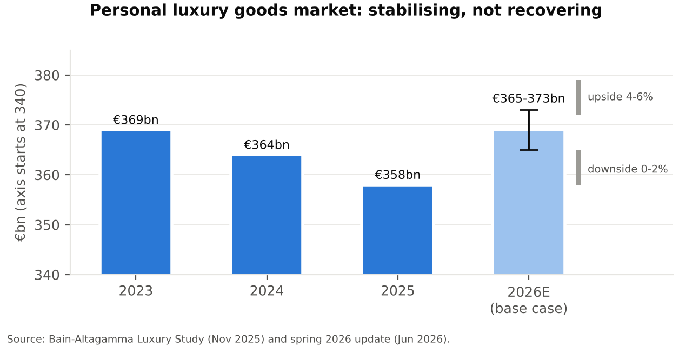
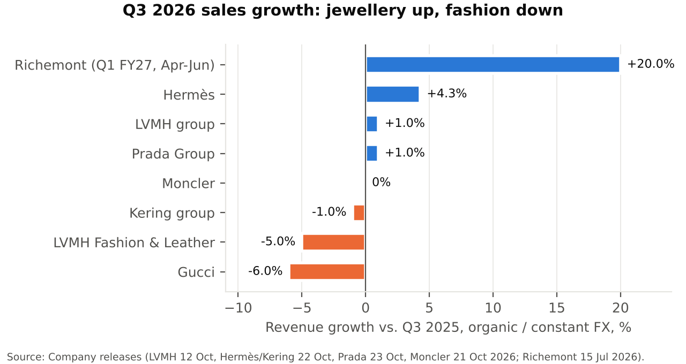
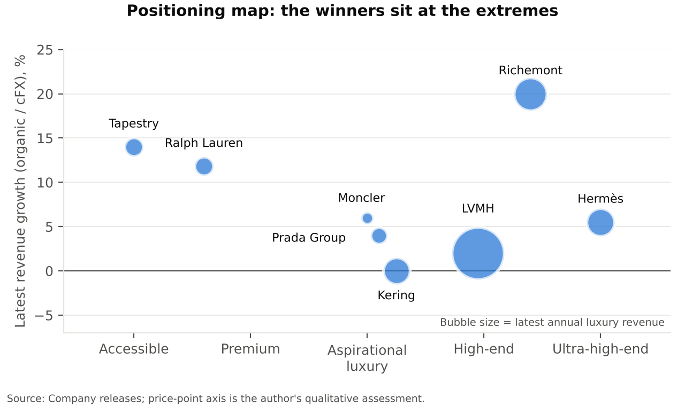
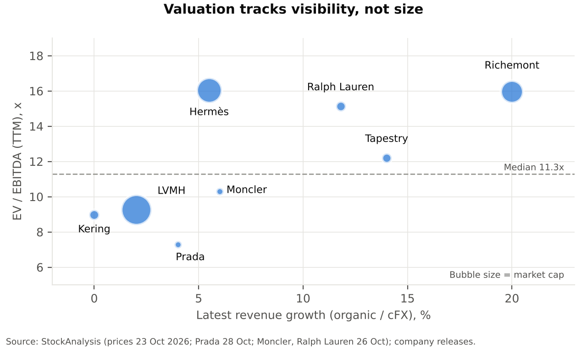
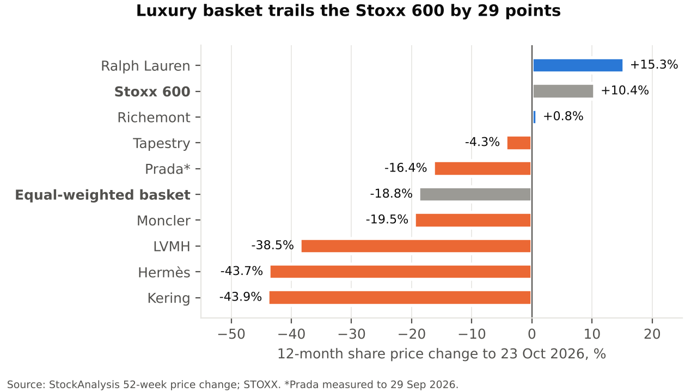

# Sector Overview #1 | Luxury Goods | October 2026

Report date: 29 October 2026. Coverage: Europe, US, China. All market data "as of" the date stated next to it.

---

## 1. Key takeaways

1. **The market is stabilising, not recovering.** Bain-Altagamma sized personal luxury goods at €358bn in 2025 (down 2% reported, flat at constant FX) and forecasts €365-373bn for 2026 (+2% to +4%) in its June base case, which it weights at 70%.
2. **Q3 2026 broke the recovery narrative.** LVMH Fashion & Leather Goods fell 5% organically against a consensus of around -1.8%; Gucci fell 6% on a comparable basis; Hermès grew 4.3% at constant FX, its slowest quarter since early 2020.
3. **China is the swing factor again.** Sales at the 25 largest luxury brands in China fell more than 10% year on year in July 2026, as an offshore-wealth tax campaign hit the richest buyers. LVMH's Asia ex-Japan swung from +7% organic in Q1 to -5% in Q3.
4. **Hard luxury is the clear winner.** Richemont's Jewellery Maisons grew 24% at constant FX in Q1 FY27 (seventh consecutive double-digit quarter). A BofA hard-luxury basket outperformed soft luxury by more than 40 percentage points between April and early September.
5. **Valuations are at decade lows for the leaders.** The MSCI Europe Textiles, Apparel & Luxury index was down 25% YTD by 9 October; LVMH, Hermès and Kering are each down roughly 40% YTD, and LVMH trades at about 16x forward earnings, its lowest in more than ten years.

---

## 2. Sector snapshot

**Size.** Bain-Altagamma estimates total luxury spending (goods and experiences, nine segments) at about €1.44tn in 2025. Personal luxury goods (PLG: leather goods, apparel, shoes, jewellery, watches, beauty, eyewear) are the core of the listed universe at €358bn in 2025, after €364bn in 2024 and €369bn in 2023.

**Growth.** 2024 was the first PLG contraction in 15 years outside Covid. For 2026, Bain's scenarios are: base case +2% to +4%; upside +4% to +6% (Middle East easing, China recovering); downside 0% to +2%. Longer term, Bain projects €525-625bn of PLG by 2035.

**Sub-segments and momentum.**
| Category | 2025-26 trend |
|---|---|
| Jewellery | Strongest category; branded fine jewellery treated as a store of value |
| Leather goods | Weak at the aspirational end, resilient at the very top (Hermès leather +10.8% in Q3) |
| Shoes | Weakest category in recent years; Bain expects an uptick from H2 2026 |
| Watches | Stabilising after a prolonged slowdown (Richemont watchmakers +8% in Q1 FY27) |
| Beauty / fragrances | Steady; supported by M&A (L'Oréal / Kering Beauté) |
| Second-hand | ~€50bn in 2025, growing 4-6%, faster than new goods |

**Value chain.** Raw materials and artisanal manufacturing (increasingly vertically integrated: Hermès is adding leather workshops through 2030; Prada has 24 owned factories) → brand / design → distribution (directly operated retail is dominant: 71% of Richemont sales; Prada retail ~87% of revenue) → clienteling and after-sales. Value accrues overwhelmingly to the brand owner that controls retail and pricing.

---

## 3. Market dynamics

**Demand drivers.**
- **Wealth effects.** High-spenders represent about 46-47% of the PLG market, so equity markets and property prices matter more than wages. Bain linked stable 2025 US demand to strong stock markets; in China, falling property values and equity prices are now weighing on the same cohort.
- **A shrinking customer base.** Bain estimates luxury buyers fell from about 400m in 2022 to about 340m in 2025, with a further 20-30m expected to drop out. Years of price increases pushed aspirational buyers out.
- **Tourism flows.** Spending is highly mobile (Chinese buyers shopping in Japan and Europe, Gulf hubs as transit malls). Three tourism shocks hit in 2026: the Middle East war, a weak Chinese outbound shopper, and riots in France.
- **Experiences over objects.** Bain finds luxury experiences growing about 1.5x faster than goods in 2026, pulling share of wallet away from product.

**Cost structure.** Gross margins are very high (Tapestry adjusted gross margin 76.6%), but retail networks, rent and marketing make the cost base largely fixed. Operating leverage therefore cuts both ways: Bain estimates EBIT margins for a sample of PLG brands at 15-16% in 2025, back to 2009 levels, from a 23% peak in 2012. Dispersion is extreme: Hermès held a ~41% recurring operating margin in H1 2026, while Kering's EBIT is around €1.6bn on €14.5bn of trailing revenue.

**Pricing power.** It is now selective. BCG-Altagamma found about 70% of luxury consumers had walked away from a purchase in the past year because the price felt unjustified. Only scarcity brands (Hermès leather, Cartier and Van Cleef jewellery) are still taking price without volume loss. LVMH has said it does not favour drastic price cuts at Louis Vuitton.

**Cyclicality.** The sector behaves as a high-beta consumer play: earnings fall faster than sales in a downturn (fixed costs) and recover faster on the way up. JPMorgan strategists note European luxury has historically outperformed the market by 9-12% on average after the University of Michigan consumer sentiment index troughs.

---

## 4. Macro and regulatory backdrop

**United States (largest growth contributor).**
- Tariffs: the Supreme Court struck down the IEEPA tariffs on 20 February 2026. They were replaced by a 10% global Section 122 surcharge (24 February to 24 July 2026), then by new Section 301 tariffs, with EU goods in the 10% bracket from 24 July. Net effect: lower than the 20% IEEPA rate on EU goods at the start of the year, but not zero.
- Demand: the US has been the most resilient region in 2026 (LVMH, Hermès, Richemont Americas +27% in Q1 FY27; Tapestry North America +15% at cFX in FY26), although Reuters flags early signs of slowing US consumer spending and Gucci slipped slightly in North America in Q3.

**China (the swing factor).**
- A campaign to tax offshore wealth required wealthy taxpayers with offshore trusts to declare assets and settle liabilities before a 22 October deadline. LVMH's CFO linked weaker Chinese confidence directly to this enforcement.
- Sales at the top 25 luxury brands in China fell more than 10% in July (three data providers cited by Bloomberg); Bernstein/Mertico mall data showed -12%. China retail sales growth slowed to 0.6% in July.
- Bain estimates mainland China PLG contracted 3-5% in 2025, a much milder fall than the sharp decline of 2024, and expected modest growth in 2026 (January 2026 report, before the tax campaign). About 65% of Chinese luxury spending now happens on the mainland. Hainan duty-free has been reformed (island-wide regime from November 2025) and is a policy lever, but local spending there fell 29% in 2024.

**Europe.**
- Tourist inflows weakened (Moncler EMEA -8% in Q3, citing weak local demand and fewer Asian tourists).
- France: protests over the cost of living turned violent on 17-18 October 2026; luxury boutiques were looted in Paris, Marseille and Bordeaux, curfews were imposed in parts of Paris, and brands boarded up stores ahead of further marches on 24 October.
- Rates: the ECB raised its deposit rate by 25bp to 2.50% on 10 September 2026 (effective 16 September). On 29 October it held at 2.50%, citing upside inflation risk from energy prices; Christine Lagarde will step down on 7 February 2027. Higher-for-longer rates weigh on aspirational demand and on leveraged Kering.
- FX: EUR/USD closed at 1.1154 on 28 October versus 1.1732 on 1 January, so the euro is down about 4.9% against the dollar YTD. That is a modest translation tailwind for euro reporters' US sales; the weaker yen remained a headwind (Hermès: about €310m of negative FX on nine-month sales).

**Middle East.** The US/Israel-Iran war from early 2026 closed or disrupted Gulf air hubs. Bernstein estimated the region at 6-8% of top brands' revenue and expected regional luxury sales to halve in March. A truce followed in April, but the region is still negative in Q3 (Hermès -4.5%; Prada retail -23% over nine months).

---

## 5. Competitive landscape

The industry is concentrated at the top: a handful of groups take the bulk of profit. The ten groups below account for roughly 43% of the €358bn PLG market (approximate shares in the second table).

| Group | Key brands | 9M 2026 revenue | Latest growth (organic / cFX) | Positioning |
|---|---|---|---|---|
| LVMH | Louis Vuitton, Dior, Tiffany, Bulgari, Sephora | €57.1bn | Q3 +1% (F&LG -5%) | Diversified conglomerate; fashion engine stalling |
| Richemont | Cartier, Van Cleef & Arpels, Buccellati | €6.33bn (Q1 FY27 only) | Q1 FY27 +20% | Hard-luxury leader; net cash €9.1bn |
| Hermès | Hermès | €12.3bn | Q3 +4.3% | Ultra-high-end scarcity model; ~41% margin |
| Kering | Gucci, Saint Laurent, Bottega Veneta | €10.6bn | Q3 -1% (Gucci -6%) | Turnaround under Luca de Meo; deleveraging |
| Chanel (private) | Chanel | €19.3bn (FY25) | FY25 +2% cFX | Private; returned to growth under Matthieu Blazy |
| Prada Group | Prada, Miu Miu, Versace | €4.54bn | Q3 +1% organic | Versace integration; Miu Miu decelerating |
| Tapestry (US) | Coach, Kate Spade | $8.0bn (FY to Jun-26) | FY26 +14% | Accessible luxury winner; Gen Z traction |
| Moncler | Moncler, Stone Island | €1.90bn | Q3 flat | Outerwear specialist; strong Asia |
| Armani (private) | Giorgio Armani | €2.19bn (FY25 net rev.) | FY25 -2.8% organic | Stake sale in progress |
| Ralph Lauren (US) | Ralph Lauren | $8.11bn (FY to Mar-26) | FY26 +11.8% cFX | Full-price strategy; FY27 guided +4-5% cFX |

**Approximate PLG market share (estimate).** Latest full-year luxury revenue divided by Bain's €358bn 2025 PLG market. Company revenue is booked partly at wholesale prices while Bain measures retail value, fiscal years differ, and Tapestry and Ralph Lauren sit at the premium edge of Bain's definition, so treat these as orders of magnitude. USD converted at 1.1154.

| Group | Luxury revenue basis | Revenue | Share |
|---|---|---|---|
| LVMH | F&LG + W&J + P&C, FY25 | €56.4bn | ~15.8% |
| Richemont | FY to Mar-26 | €22.4bn | ~6.3% |
| Chanel | FY25 | €19.3bn | ~5.4% |
| Hermès | FY25 | €16.0bn | ~4.5% |
| Kering | FY25 | €14.7bn | ~4.1% |
| Ralph Lauren | FY to Mar-26 | €7.3bn | ~2.0% |
| Tapestry | FY to Jun-26 | €7.2bn | ~2.0% |
| Prada Group | FY25 | €5.7bn | ~1.6% |
| Moncler | FY25 | €3.1bn | ~0.9% |
| Armani | FY25 net revenue | €2.2bn | ~0.6% |
| **Top 10** | | **€154.3bn** | **~43%** |

**Who is gaining and losing share.**
- **Gaining:** jewellery specialists (Richemont, Kering Jewelry +11% in Q3, LVMH Watches & Jewelry +8% over nine months), accessible luxury with sharp value-for-money (Coach +24% in FY26), and Hermès at the very top.
- **Losing:** brands dependent on aspirational Chinese buyers and on logo-led leather goods (Gucci, Louis Vuitton in China), and brands exposed to Gulf tourism (Miu Miu).

---

## 6. Trading comps

**Basis.** Free data (StockAnalysis), not a terminal. Prices at close on 23 October 2026 unless noted. EV/EBITDA and EBITDA margin are trailing twelve months (TTM); P/E is forward. Revenue growth is the latest reported organic or constant-currency figure, so periods differ (noted per company). Converted to EUR at EUR/USD 1.1202 and EUR/CHF 0.9243 (23 October close); HKD via the USD peg at about 7.78 per dollar.

| Company | Mkt cap (€bn) | EV (€bn) | EV/EBITDA (TTM) | P/E (fwd) | Rev. growth (latest) | EBITDA margin (TTM) | Div. yield |
|---|---|---|---|---|---|---|---|
| LVMH | 188.9 | 215.4 | 9.3x | 16.5x | +2% (9M org.) | 25.2% | 3.4% |
| Hermès | 129.7 | 119.7 | 16.0x | 26.3x | +5.5% (9M cFX) | 43.7% | 1.5% |
| Richemont | 102.8 | 99.1 | 16.0x | 22.6x | +20% (Q1 FY27 cFX) | 23.9% | 2.0% |
| Kering | 21.8 | 32.1 | 9.0x | 21.3x | 0% (9M comp.) | 17.4% | 1.7% |
| Prada* | 11.3 | 15.3 | 7.3x | 13.6x | +4% (9M org.) | 24.6% | 4.0% |
| Moncler** | 11.7 | 11.8 | 10.3x | 17.6x | +6% (9M cFX) | 28.5% | 3.3% |
| Tapestry | 19.6 | 22.1 | 12.2x | 13.9x | +14% (FY to Jun-26) | 25.3% | 1.7% |
| Ralph Lauren** | 20.6 | 21.5 | 15.1x | 19.8x | +11.8% (FY to Mar-26 cFX) | 19.1% | 1.0% |
| **Median** | | | **11.3x** | **18.7x** | **+5.8%** | **24.9%** | **1.9%** |
| **Mean** | | | **11.9x** | **18.9x** | **+7.9%** | **26.0%** | **2.3%** |

*Prada priced at the 28 October 2026 close (HK$37.60); market cap, EV and multiples rolled forward from the source's 29 September data at constant share count and net debt, converted at EUR/USD 1.1154. **Moncler and Ralph Lauren priced 26 October 2026.

**Reading the table.**
- The market pays for visibility, not size. Hermès and Richemont trade at about 16x EV/EBITDA, close to double LVMH (9.3x) and Kering (9.0x), because their growth is either the steadiest or the fastest in the group.
- LVMH looks cheap on every metric (16.5x forward P/E, 3.4% yield, EV/EBITDA below the US names): the market is pricing in the Louis Vuitton slowdown in China.
- Kering's 21x forward P/E overstates its valuation: depressed earnings and net debt inflate it, and on EV/EBITDA (9x) it is among the cheapest names.

**Valuation context (sourced).**
- In early September, BofA put the sector at about 25x forward earnings, close to its 10-year average, with LVMH at a 25% discount to peers, the widest in ten years.
- Since then the leaders have de-rated further: Bloomberg reported on 23 October that Europe's biggest luxury firms trade at their cheapest levels in more than a decade. On our 23 October pricing, the eight-name median forward P/E is about 19x, well below that 25x reference.
- Premium/discount drivers: growth visibility (Hermès, Richemont), margin resilience and net cash (Hermès €12.3bn, Richemont €9.1bn) versus leverage (Kering net debt €9.5bn at June 2025 before the Kering Beauté disposal).

---

## 7. Recent performance and capital markets activity

**Share price performance.**
- MSCI Europe Textiles, Apparel & Luxury Goods: **-25% YTD** as of 9 October 2026, a deeper fall than autos, the worst Stoxx 600 sub-index at -21%.
- Stoxx 600: +6.7% YTD and +10.4% over 12 months at the 23 October close.
- The six largest European listed luxury groups lost a combined **€251bn** of market value YTD (FT, 25 October), led by LVMH and Hermès.
- 12-month price change to 23 October: an equal-weighted basket of the eight comps names fell -18.8% versus +10.4% for the Stoxx 600, a 29-point gap. Range: Ralph Lauren +15.3% to Kering -43.9% (Prada measured to 29 September).

**M&A (last 12 months).**
| Date | Deal | Value | Rationale |
|---|---|---|---|
| Closed 31 Mar 2026 | L'Oréal acquires Kering Beauté (Creed + 50-year licences for Bottega Veneta, Balenciaga; Gucci from ~2028) | €4.0bn | Kering deleveraging; L'Oréal scales luxury fragrance |
| Closed 2 Dec 2025 | Prada Group acquires Versace from Capri Holdings | ~€1.25bn | Third fashion pillar; Versace contributed €441m in 9M 2026 |
| In progress (talks Sep-Oct 2026) | Armani 15% minority stake to LVMH, L'Oréal and/or EssilorLuxottica | Implied ~€10bn equity value (FT) | Succession under the founder's will; listing or larger sale to follow |
| Announced 19 Jan 2026 | DFS (LVMH) sells its Hong Kong and Macau retail business to CTG Duty Free; LVMH and the Miller family subscribe to new CTG H-shares | Undisclosed (HSBC values all of DFS at ~€1.2bn) | Exit from Greater China travel retail; strategic tie-up with China's duty-free leader |
| Announced May 2026 (closing pending) | LVMH sells Marc Jacobs to WHP Global and G-III (50/50) | $850m | Portfolio pruning; together with DFS, a -1% perimeter effect on 9M revenue |
| H1 2026 | Richemont sells its Avolta stake | ~€0.4bn cash inflow | Non-core; lifted net cash to €9.1bn |

**DCM.**
- LVMH (AA- / Aa3): €1.5bn dual tranche in February 2026: €750m 2.625% due June 2030 and €750m 3.375% due February 2036, guided at about MS+65bp and MS+100bp.
- L'Oréal: €3bn triple tranche (November 2025) partly funding Kering Beauté, then a further €1.75bn in early 2026.
- Kering: no new bond issue identified in 2026; the Kering Beauté proceeds (€4bn, March 2026) did the deleveraging work instead.

**ECM.** No completed luxury IPO identified in the last 12 months: with sector multiples at decade lows, the window is effectively shut. Pipeline names from earlier years (OTB had targeted 2026) have not come to market. The Armani will provides for a possible listing after the initial stake sale, which would be the main ECM event to watch.

---

## 8. Key themes for the next 12-24 months

**Theme 1: Hard luxury keeps outgrowing soft luxury.**
Jewellery is behaving as a store of value and a less logo-driven purchase, and Richemont has posted seven straight double-digit quarters. *So what:* expect continued M&A appetite for jewellery assets and a valuation premium for jewellery-heavy groups; soft-luxury houses will push harder into jewellery (Kering Jewelry, LVMH Bulgari and Tiffany).

**Theme 2: China resets from engine to option.**
Tax enforcement, property deflation and local alternatives are compressing demand from the top cohort. *So what:* consensus 2027 numbers that assume a China rebound are at risk; brands with low China weight and high US weight (Tapestry, Richemont in the Americas) should hold up better, and store closures in China (Gucci, Louis Vuitton) will continue.

**Theme 3: Value for money becomes the brand promise.**
After a decade of price increases, consumers are walking away from purchases they judge overpriced. *So what:* the industry splits between true scarcity brands that can still raise prices and the rest, which must reinvest in product quality and creative renewal (new designers at most big houses in 2025-26) rather than price.

**Theme 4: Balance sheets drive portfolio reshaping.**
Kering is selling assets and closing stores (105 net closures so far, targeting 125 by year end); the Valentino put options were pushed to 2028-29; Armani is opening its capital. *So what:* more disposals, licensing deals and minority stake sales; cash-rich groups (LVMH, Richemont, Hermès, L'Oréal) are the natural buyers at depressed valuations.

---

## 9. Risks: bull case vs. bear case

| | Bull case | Bear case |
|---|---|---|
| Demand | Chinese wealthy resume spending once the tax deadline passes; Bain upside case (+4-6%) plays out | China decline persists into 2027; US slows as equity markets correct |
| Margins | Fixed-cost leverage reverses quickly on any top-line recovery | Continued marketing and creative reinvestment caps margins near 2009 levels |
| Valuation | Decade-low multiples; history shows outperformance after consumer sentiment troughs | Multiples are low because earnings estimates are still too high; further cuts (Deutsche Bank already warned) |
| Geopolitics | Durable Middle East truce restores Gulf tourism; tariffs stay at 10% | Renewed conflict, new US tariff actions, or prolonged unrest in France deter tourists |
| Structure | Creative resets (Gucci, Dior) land and bring back the aspirational buyer | The customer base keeps shrinking (Bain: a further 20-30m buyers lost) |

---

## 10. Names to watch (no ratings)

**Richemont.** The cleanest exposure to the strongest category. Q1 FY27 sales rose 20% at constant FX, every region grew double digits except the Middle East, and the group holds €9.1bn of net cash. The key question is whether gold-price-driven demand and a premium valuation can coexist if jewellery growth normalises. Next catalyst: H1 FY27 results on 13 November 2026.

**Hermès.** The sector's quality benchmark has halved its multiple: about 26x forward earnings today versus roughly 48x in mid-2025, after a ~40% YTD fall to a four-year low. The Q3 slowdown came from ready-to-wear and accessories, not leather goods (+10.8%). The debate: less immune than believed, or an overshoot for a business with a ~41% margin and €12.3bn of net cash (€12.9bn restated)?

**Kering.** The highest-beta recovery option in the sector. Gucci is still shrinking (Q3 retail -9%), but jewellery and eyewear are growing, the Kering Beauté sale cut leverage, and the market cap has fallen to about €22bn. The stock will trade on proof that the Gucci product reset works; management has declined to confirm a return to group growth this year.

---

## 11. Sources

**Market sizing and industry studies**
- Bain & Company, "Finding a new longevity for luxury" (Dec 2025): https://www.bain.com/insights/finding-a-new-longevity-for-luxury/
- Bain & Company, "Luxury is ready for a new era" (Nov 2025): https://www.bain.com/el/insights/luxury-is-ready-for-a-new-era-after-stabilizing-in-2025-snap-chart/
- FashionUnited, Bain-Altagamma 2025 study (high spenders, 2035 outlook): https://fashionunited.uk/news/business/global-luxury-stays-resilient-despite-economic-uncertainties-and-consumer-shifts/2025112085007
- Luxury Travel Advisor, Bain-Altagamma EBIT margins: https://www.luxurytraveladvisor.com/your-business/bain-altagamma-study-global-luxury-stays-resilient
- IADS, first contraction in 15 years (2024): https://www.iads.org/articles-reports/bain-altagamma-luxury-goods-worldwide-study-forecasts-long-term-growth
- WWD, luxury footwear outlook: https://wwd.com/footwear-news/shoe-industry-news/luxury-shoe-sales-bain-altagamma-study-improvement-2026-1239030638/
- Communicate Online, Bain spring 2026 update (scenario probability, experiences): https://communicateonline.me/news/bain-sees-luxury-stabilizing-despite-geopolitical-economic-headwinds/
- Epignosis Insights, Bain scenarios and customer base: https://epignosisinsights.com/blog/luxury-market-2026-why-growth-is-coming-back-on-different-terms
- Online Luxury Shops, BCG-Altagamma price perception: https://onlineluxuryshops.com/articles/luxury-shopping-statistics.html
- Bain & Company, China personal luxury market 2025 (Jan 2026): https://www.bain.com/about/media-center/press-releases/2026/chinas-personal-luxury-market-contracts-35-in-2025-but-shows-signs-of-recovery/

**Company releases and results coverage**
- LVMH, Q3 2026 revenue release: https://lvmh-com.cdn.prismic.io/lvmh-com/Y6AfTE0Y7WFnyftQ_LVMH2026ThirdQuarterRevenue.pdf
- LVMH, FY2025 results: https://www.nasdaq.com/press-release/lvmh-solid-performance-disrupted-global-economic-and-geopolitical-environment-2026-01
- The Impression, LVMH Q3 2026 (regional trend): https://theimpression.com/lvmh-q3-2026-results/
- Reuters via KSL, LVMH Q3 and US consumer: https://www.ksl.com/article/51635399/lvmh-third-quarter-sales-dragged-down-by-weak-chinese-demand-for-flagship-brands
- FXEmpire, LVMH and China tax enforcement: https://www.fxempire.com/forecasts/article/lvmh-shares-is-chinas-luxury-slowdown-becoming-a-structural-problem-1637765
- IndexBox, Deutsche Bank estimate cuts: https://www.indexbox.io/blog/lvmh-q3-2026-revenue-rises-12-to-eur185-billion-as-china-weakness-hits-fashion-and-leather-goods/
- Hermès, Q3 2026 revenue release: https://fr.finance.yahoo.com/actualites/herm%C3%A8s-international-chiffre-daffaires-3%C3%A8me-060000299.html
- Hermès, 2026 half-year results: https://www.globenewswire.com/news-release/2026/07/29/3334976/0/en/Herm%C3%A8s-International-2026-Half-year-Results.html
- Hermès, 2025 full-year results: https://www.mfn.se/one/a/hermes/hermes-international-2025-full-year-results-a01f2a5e
- The Silent Luxury, Hermès Q3 2026 (slowest quarter since 2020): https://the-silent-luxury.com/hermes-q3-2026-results/
- Pulse 2.0, Hermès workshop pipeline: https://pulse2.com/hermes-reports-q3-2026-revenue-of-e4-1-billion-and-nine-month-sales-of-e12-3-billion-as-americas-and-leather-goods-drive-growth/
- Kering, Q3 2026 revenue release: https://www.globenewswire.com/news-release/2026/10/22/3386683/0/en/kering-revenue-for-the-third-quarter-of-2026.html
- Yahoo Finance, Kering Q3 (Gucci retail): https://finance.yahoo.com/markets/stocks/articles/kering-slides-gucci-sales-fall-163516532.html
- Euronext / Reuters, Gucci sales and store closures: https://live.euronext.com/en/financial-news/gucci-sales-slip-again-latest-blow-kering-recovery-plan
- World Footwear, Kering FY2025: https://www.worldfootwear.com/news/kering-posts-third-straight-year-of-falling-sales/11250.html
- Richemont, Q1 FY27 release: https://www.richemont.com/news-media/press-releases-news/richemont-posts-strong-start-to-the-year-with-sales-up-by-20-at-constant-rates-for-its-first-quarter-ended-30-june-2026/
- GJEPC, Richemont Q1 FY27 detail: https://gjepc.org/solitaire/?p=37291
- Business Day, Richemont FY2026: https://www.businessday.co.za/companies/2026-06-01-ruperts-crown-jewel-richemont-closes-in-on-r2-trillion-market-valuation/
- Retail Insight Network, Prada 9M 2026: https://www.retail-insight-network.com/newsletters/prada-net-revenues-12-first-nine-month
- Luxury Tribune, Prada 9M 2026 (retail share): https://www.luxurytribune.com/en/prada-group-11-growth-in-q3-2026-miu-miu-is-slowing-down
- Finimize, Prada Q3 2026: https://finimize.com/content/prada-kept-growing-even-as-luxury-demand-softened
- ANSA, Prada FY2025: https://www.ansa.it/english/news/2026/03/05/prada-2025-revenues-up-to-5.7-billion-profit-of-852-million_274bf34b-7e88-42d5-8df8-5f59949fd5ce.html
- Retail Insight Network, Moncler Q3 2026: https://www.retail-insight-network.com/newsletters/moncler-group-q3-revenue-flat
- Quartr, Moncler Q3 2026 and FY2025: https://quartr.com/events/moncler-s-p-a-monc-q3-2026_oqeYI8y0
- Modaes, Tapestry FY2026: https://www.modaes.com/global/companies/tapestry-increased-its-sales-by-14-in-the-last-fiscal-year-to-s8004-million
- FashionUnited, Ralph Lauren FY2026: https://fashionunited.uk/news/business/ralph-lauren-surpasses-8-billion-dollars-in-annual-revenue/2026052188192
- Modaes, Chanel FY2025: https://www.modaes.com/global/companies/chanel-bounces-back-in-2025-3-growth-and-49-increase-in-operating-profit
- The Impression, Chanel return to growth: https://theimpression.com/?p=11935328
- FashionUnited, Armani FY2025: https://fashionunited.uk/news/business/armani-groups-2025-results-sales-decline-profitability-improves/2026042987745

**Macro, regulation and geopolitics**
- The Star / Bloomberg, China luxury sales plunge: https://www.thestar.com.my/business/business-news/2026/08/24/luxury-sales-plunge-china
- Modaes, Bernstein China mall data: https://www.modaes.com/global/markets/luxury-sales-lose-momentum-again-in-china-due-to-taxes-on-high-net-worth-individuals
- Logos Press, China retail sales July 2026: https://logos-pres.md/en/news/tax-pressure-has-reached-the-luxury-sector-wealthy-chinese-are-changing-their-habits/
- FashionNetwork, Hainan duty-free policy: https://us.fashionnetwork.com/news/Hainan-s-duty-free-rally-hinges-on-wary-chinese-consumers,1825680.html
- FashionNetwork / Reuters, Hainan spending 2024: https://us.fashionnetwork.com/news/Trouble-in-china-s-shopping-paradise-as-hainan-duty-free-spending-falls-29-,1689422.html
- Wiley, Section 122 tariffs: https://www.wiley.law/alert-Trump-Imposes-Section-122-Tariffs-After-Halting-IEEPA-Tariffs-Previews-New-Section-301-Investigations
- Zonos, US tariff timeline: https://zonos.com/us-tariff-updates
- Al-Monitor, Dubai luxury and the Middle East war: https://www.al-monitor.com/originals/2026/04/dubais-luxury-stores-take-hit-mideast-war-drags
- NSS Magazine, Middle East truce: https://www.nssmag.com/en/fashion/44962/dubai-luxury-crisis-tourism-decline-middle-east-war
- Oman Observer / Reuters, French unrest 17-18 October: https://www.omanobserver.om/article/1197997/world/europe/france-counts-cost-of-worst-unrest
- Luxury Tribune, Paris curfew: https://www.luxurytribune.com/en/paris-under-curfew-french-luxury-faces-the-cost-of-the-riots
- The Star / Reuters, luxury stores board up: https://www.thestar.com.my/news/world/2026/10/24/france039s-luxury-stores-board-up-windows-ahead-of-fresh-protests
- Admiral Markets, ECB September 2026 hike: https://admiralmarkets.com/analytics/traders-blog/ecb-meeting-october-2026
- Finwire, ECB holds rates on 29 October 2026: https://finwire.io/news/economy-news/ecb-keeps-rates-steady-as-president-lagarde-annouces-departure
- Euronews, Lagarde departure date: https://www.euronews.com/2026/10/29/ecb-president-christine-lagarde-to-step-down-in-february-months-before-her-term-ends
- Pound Sterling Live, EUR/USD 2026: https://www.poundsterlinglive.com/history/EUR-USD-2026
- Pound Sterling Live, EUR/CHF 2026: https://www.poundsterlinglive.com/history/EUR-CHF-2026

**Markets, valuation and deals**
- StockAnalysis, statistics pages (LVMH, Hermès, Richemont, Kering, Prada, Moncler, Tapestry, Ralph Lauren): https://stockanalysis.com/quote/epa/MC/statistics/ , https://stockanalysis.com/quote/epa/RMS/statistics/ , https://stockanalysis.com/quote/swx/CFR/statistics/ , https://stockanalysis.com/quote/epa/KER/statistics/ , https://stockanalysis.com/quote/hkg/1913/statistics/ , https://stockanalysis.com/quote/bit/MONC/statistics/ , https://stockanalysis.com/stocks/tpr/statistics/ , https://stockanalysis.com/stocks/rl/statistics/
- STOXX, Europe 600 index: https://stoxx.com/index/sxxp/
- Bloomberg, luxury stocks (9 Oct 2026): https://www.bloomberg.com/news/articles/2026-10-09/luxury-stock-bulls-have-to-wait-longer-for-a-revival
- Asia Business Daily, decade-low valuations: https://www.asiae.co.kr/en/article/2026102409245749193
- Izvestia, FT market value loss: https://iz.ru/en/node/2190479
- FashionNetwork / Bloomberg, BofA and JPMorgan views: https://us.fashionnetwork.com/news/Luxury-tends-to-bounce-when-confidence-is-this-low,1862794.html
- LVMH, Debt & Ratings: https://www.lvmh.com/en/investors/debt-ratings
- L'Oréal / Euronext, Kering Beauté completion and bonds: https://live.euronext.com/it/listview/company-press-release/002911
- Korea Times / Reuters, Kering Beauté deal: https://www.koreatimes.co.kr/amp/world/20251021/gucci-owner-kering-sells-beauty-unit-to-loreal-for-47-bil
- FashionNetwork, Prada completes Versace: https://us.fashionnetwork.com/news/Prada-completes-its-acquisition-of-versace,1788064.html
- LVMH, DFS Greater China sale: https://www.lvmh.com/en/publications/dfs-and-china-tourism-group-duty-free-announce-agreement-for-sale-and-purchase-of-dfs-greater-china-retail-business
- FashionUnited, DFS sale (HSBC valuation): https://fashionunited.uk/news/business/lvmh-sells-its-travel-retail-business-dfs-in-china/2026012185860
- Retail Insight Network, Marc Jacobs sale: https://www.retail-insight-network.com/newsletters/lvmh-sell-marc-jacobs-for-850m
- Retail Gazette, Armani stake talks: https://www.retailgazette.co.uk/blog/2026/09/armani-to-open-stake-sale-talks-with-lvmh-and-loreal/
- Finimize, Armani valuation (citing FT): https://finimize.com/content/armani-weighs-a-15-stake-sale-to-luxury-giants
- The Fashion Law, Kering / Mayhoola Valentino: https://www.thefashionlaw.com/behind-the-deal-kering-mayhoola-reset-the-clock-on-valentino-acquisition/
- CPP Luxury, UBS on Hermès valuation (mid-2025): https://cpp-luxury.com/luxury-industry-to-see-significant-recovery-by-the-end-of-2026-ubs/
- Luxury Tribune, OTB IPO timing: https://www.luxurytribune.com/en/otb-group-postpones-ipo-to-2026

---

*Student research for educational purposes only. Not investment advice.*
