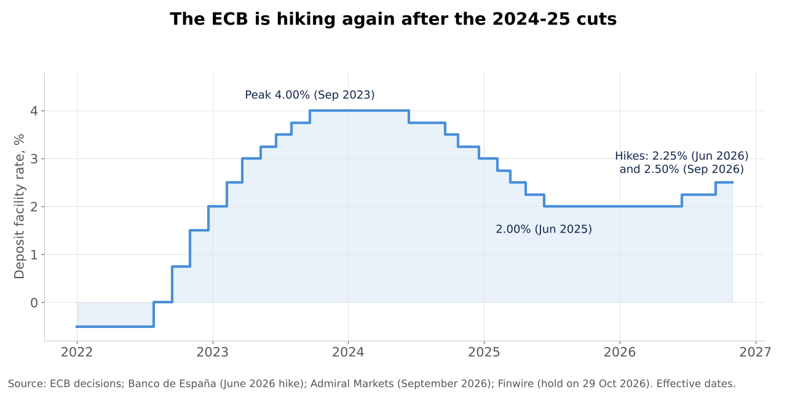
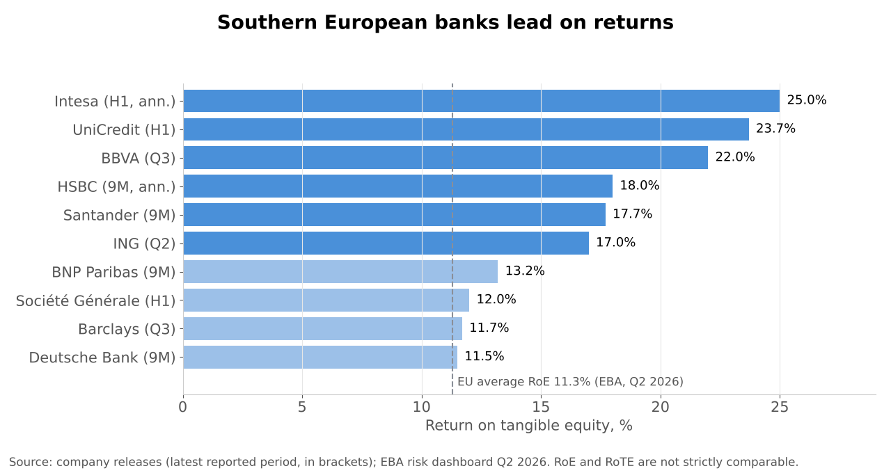
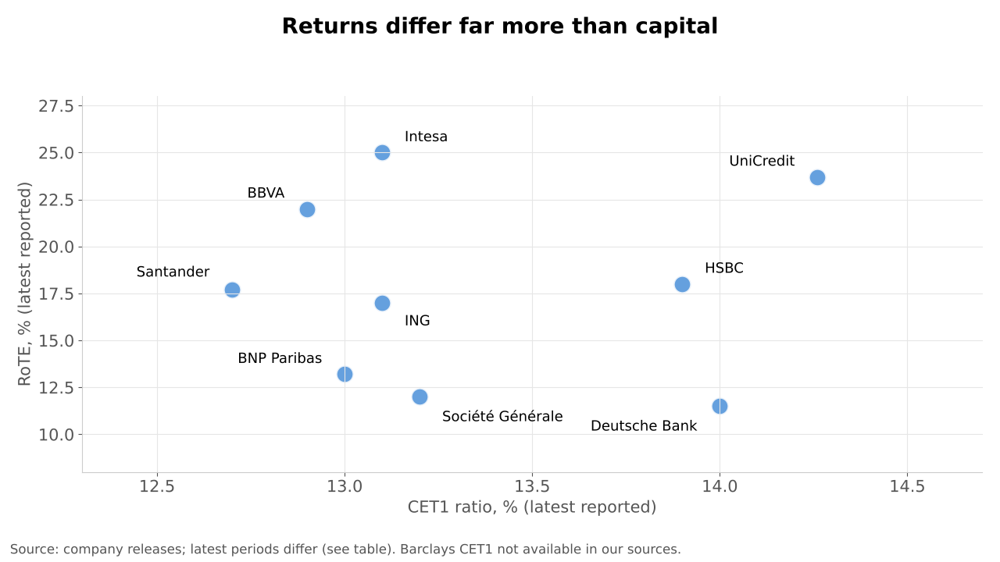
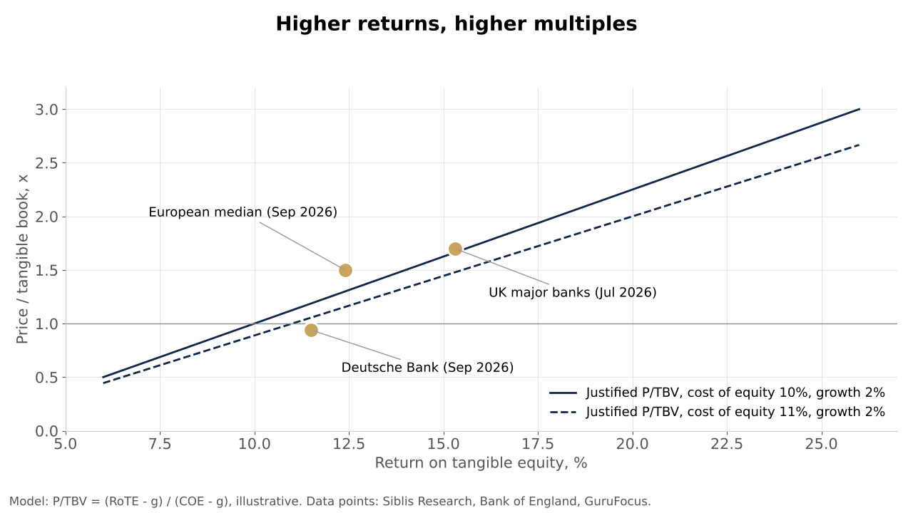
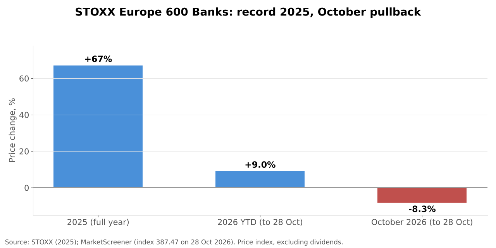

# Sector Overview #2 | European Banks | November 2026

Published: 5 November 2026. Data as of 30 October 2026; market data "as of" the date stated next to it. Coverage: EU and UK listed banks.

---

## 1. Key takeaways

1. **Profitability is at a post-crisis high.** EU banks posted a return on equity of 11.3% in Q2 2026 (EBA), up from 10.7% a year earlier. The leaders are far above that: UniCredit reported a 23.7% RoTE in H1 2026, BBVA about 22% in Q3, HSBC 18.0% annualised over nine months and Santander 17.7%.
2. **Rates turned back up.** The ECB raised its deposit rate to 2.25% in June 2026 and to 2.50% in September, its first hikes since 2023, citing inflation pressure from the Middle East war. Net interest income is growing again (Société Générale +12.7% and BBVA +16.5% in Q3).
3. **The rally paused in October.** After a record 2025 (STOXX Europe 600 Banks +67%), the index was up 9.0% YTD on 28 October but down 8.3% month to date, hit by French sovereign stress: the OAT-Bund spread touched about 178bp on 22 October, the widest since 2011.
4. **Cross-border consolidation is finally happening.** On 15 October the ECB cleared UniCredit to take control of Commerzbank (economic stake about 48%). In Italy, Intesa Sanpaolo (€30.6bn offer for Monte dei Paschi) and MPS (€25.3bn offer for Banco BPM) are in an open contest.
5. **Capital is being handed back.** Banks planned about €117bn of dividends and buybacks for 2026 after about €106bn in 2025. CET1 ratios stay high (EU average 16.1%, EBA) and Brussels has delayed the FRTB market-risk rules by three years, a capital relief for trading banks.

---

## 2. Sector snapshot

**Size.** EU-headquartered banks held about €34.3tn of total assets at end-March 2026, up 3.6% year on year (ECB consolidated banking data, 335 banking groups plus stand-alone banks). The three largest European banks by assets at end-2025 were BNP Paribas ($3.28tn), HSBC ($3.21tn) and Crédit Agricole ($3.15tn) (S&P Global).

**Profitability and soundness.** The EBA Q2 2026 risk dashboard shows RoE of 11.3% (10.7% a year earlier), a CET1 ratio of 16.1% and an NPL ratio of 1.8%. The ECB's sample of significant institutions shows a similar picture (CET1 16.0%, annualised RoE 10.7%, Q2 2026). The EBA expects returns to stay above 10% and to improve slightly in 2027-28.

**Business lines and momentum.**
| Business line | 2026 trend |
|---|---|
| Retail and commercial banking (NII) | Growing again with higher rates and volumes (SocGen NII +12.7%, BBVA +16.5% in Q3) |
| Corporate lending | Euro area loans to firms +4.2% year on year in September, households +3.1% (ECB) |
| Wealth and asset management | Strong inflows and fees (Deutsche Bank wealth inflows; Intesa growth led by wealth management) |
| Markets (FICC, equities) | Mixed: Barclays cited weaker fixed income in Q3 while equities trading was strong |
| Cost of risk | Low in Europe; NPL ratio 1.8% (EBA) and Stage 2 loans down to 8.9% |

**Value chain.** Deposits (cheap funding) → lending and balance sheet management (structural hedges lock in rates for several years) → fee businesses (payments, wealth, insurance) → capital generation → distribution to shareholders. Value accrues to banks with a large, cheap deposit base and strong fee franchises, which is why Spanish, Italian and UK retail banks earn the highest returns.

---

## 3. Market dynamics

**Earnings drivers.**
- **Net interest income.** With rates at 2.50%, the "higher for longer" scenario supports margins. BNP Paribas said its retail NII rose thanks to the reinvestment of non-remunerated deposits, partly offset by pressure on lending margins.
- **Volumes.** Loan growth is modest but positive (firms +4.2%, households +3.1% in September 2026). The ECB Q3 2026 bank lending survey shows tighter credit standards and no rise in demand, so volumes are unlikely to accelerate soon.
- **Costs.** Efficiency is the main lever: Santander's efficiency ratio is 39.9%, Intesa's cost/income 35.9% (H1), while Deutsche Bank (62.4% in Q3) and Barclays (57% YTD) still have room to improve. Barclays is reported to be cutting about 5,000 jobs.
- **Cost of risk.** Credit quality remains benign in Europe. Santander's cost of risk (1.20%) is higher because of its Latin American and consumer finance exposure.

**Capital generation.** High profits and stable risk-weighted assets let banks distribute most of their earnings. Santander targets at least €10bn of buybacks against 2025-26 results and excess capital (about €9bn delivered so far); Barclays has distributed £2.8bn year to date; Commerzbank targets about €3.2bn for 2026.

**Cyclicality.** Bank earnings are geared to rates, growth and credit quality. The 2025 rally was driven by rerating from deep discounts; 2026 is more about earnings delivery and capital returns, with sovereign risk (France) as the new swing factor.

---

## 4. Macro and regulatory backdrop

**Monetary policy.**
- The ECB cut its deposit rate from 4.00% (2023 peak) to 2.00% by June 2025, then raised it to 2.25% on 11 June 2026 and to 2.50% in September 2026, citing inflation pressures from the Middle East war. On 29 October it held at 2.50%.
- For banks, higher rates support NII, but they also raise funding costs and can weigh on credit demand and asset quality if growth slows.

**France (the swing factor).**
- The French 10-year spread over Germany touched about 178bp on 22 October 2026, the widest since late 2011, before easing to about 156bp on 26 October. A minority government is negotiating its 2027 budget, and Moody's was due to review France's rating on 23 October.
- European bank stocks had their worst two-day fall since March in early October as the bond selloff spread. In early October Société Générale was about 26% below its August peak. Sovereign debt was about 13% of bank assets at end-2025, so the bank-sovereign link (the "doom loop") is back on investors' radar.

**Regulation.**
- **Basel III / CRR3** has applied in the EU since January 2025, except for the market-risk rules (FRTB). In June 2026 the Commission adopted temporary relief and, in agreement with the ECB and EBA, a three-year delay of FRTB, to wait for the US approach. The EBA had estimated FRTB would raise market-risk capital by about 30% on average.
- The EBA's CRR3/CRD6 dashboard shows a fully loaded CET1 ratio of 15.1% even after the output floor, so the sector stays well capitalised.
- **UK:** final Basel 3.1 rules are expected to lift HSBC's CET1 ratio by about 40-50bp.

**Lending conditions.** The ECB's bank lending survey shows banks tightened standards again in Q2 2026, and in Q3 found no growth in loan demand. Banks nonetheless expect higher NII to keep supporting profitability over the next 12 months.

---

## 5. Competitive landscape

European banking is fragmented across national markets; the largest banks are national champions with limited cross-border overlap, which is why cross-border M&A matters.

| Group | Home market | Latest profit | Latest RoTE | CET1 | Positioning |
|---|---|---|---|---|---|
| HSBC | UK / Asia | PBT $29.2bn 9M (+26%) | 18.0% (9M, annualised) | 13.9% | Wealth and cross-border franchise; $1bn new buyback |
| Santander | Spain | €12.4bn 9M (+20%) | 17.7% (9M) | 12.7% | Webster ($12.2bn) adds US scale; efficiency 39.9% |
| BNP Paribas | France | €3.46bn Q3 (+13.5%) | 13.2% (9M) | 13.0% (Jun) | Largest by assets; €1.3bn buyback; French spread overhang |
| UniCredit | Italy | €6.1bn H1 (+3%) | 23.7% (H1) | 14.3% (Jun) | Taking control of Commerzbank; Q3 results 9 Nov |
| BBVA | Spain | €6.05bn H1 (+11%) | ~22% (Q3) | 12.9% (Jun) | Highest returns; Mexico and Turkey; Sabadell bid failed (2025) |
| Intesa Sanpaolo | Italy | €5.6bn H1 (+6.5%) | 25% (H1, annualised) | 13.1% (Jun) | Wealth-led model; €30.6bn bid for MPS |
| Deutsche Bank | Germany | €5.9bn 9M (+7%) | 11.5% (9M) | 14.0% | Record profits; cost/income 62.4% in Q3 |
| ING | Netherlands | €1.95bn Q2 | 17.0% (Q2) | 13.1% (Jun) | Deposit-rich retail model; Q3 distribution decision pending |
| Barclays | UK | PBT £2.3bn Q3 (+12%) | 11.7% (Q3) | n/a | Restructuring; target RoTE >12% in 2026 |
| Société Générale | France | €1.9bn Q3 (record) | 12.0% (H1) | 13.2% (Jun) | Turnaround; most exposed to the French spread |

*Latest available figures as of 30 October 2026; periods differ by bank (noted). UniCredit, Intesa, BBVA and ING Q3 2026 results were not yet published or confirmed at that date. HSBC and Barclays figures are profit before tax.

**Who is gaining and losing ground.**
- **Gaining:** high-return southern European banks (UniCredit, BBVA, Intesa, Santander) and banks using excess capital for acquisitions (UniCredit in Germany, Santander in the US).
- **Under pressure:** French banks, whose valuations are tied to the sovereign spread, and banks with weaker returns that depend on cost cuts (Barclays, Deutsche Bank) to close the gap.

---

## 6. Valuation

**How banks are valued.** Banks are valued on price to tangible book value (P/TBV) rather than EV/EBITDA, because debt is their raw material. In theory, a bank earning exactly its cost of equity trades at 1.0x tangible book; the justified multiple is roughly (RoTE - g) / (COE - g), where g is long-term growth and COE the cost of equity.

**Where the sector trades (sourced).**
- The median European bank traded at about **1.5x P/TBV** at 30 September 2026, with a median RoTE of 12.4%, almost in line with US banks (12.6%) (Siblis Research, about 670 banks).
- Major UK banks traded at about **1.7x tangible book** with an aggregate underlying RoTE of 15.3% (Bank of England, July 2026).
- Spanish banks had a median P/TBV of about **1.9x** at end-2025.
- Deutsche Bank traded at about **0.9x P/TBV** in September 2026 (GuruFocus), below the industry median of 1.2x, consistent with its lower RoTE (11.5% in 9M).
- The ECB noted that euro area bank price-to-book ratios reached their highest level since before the financial crisis by February 2026, driven by stronger profitability and higher payouts.

**Reading the numbers.**
- The market now pays for returns: banks earning 17-25% RoTE trade at large premiums to book, while those earning about 10-12% are close to 1x.
- With a cost of equity around 10-11% and 2% growth, a sustainable RoTE of 12% justifies about 1.1-1.25x tangible book. The sector median of 1.5x therefore already prices in higher returns or a lower cost of equity; further rerating needs one of the two to materialise (illustrative model, chart below).
- The October selloff shows that for French banks, the cost of equity is currently driven by the sovereign spread rather than by their own results.

---

## 7. Recent performance and capital markets activity

**Share price performance.**
- STOXX Europe 600 Banks: **+67% in 2025**, its best year on record (STOXX); the euro area index (EURO STOXX Banks) gained 80.3%.
- 2026: **+9.0% YTD** at 387.47 on 28 October, but **-8.3% month to date** in October. The iShares STOXX Europe 600 Banks ETF showed a total return of 11.3% YTD on 23 October, including dividends.
- Early October brought the worst two-day fall since March on French debt worries; banks then rebounded with Q3 results.

**M&A (last 12 months).**
| Date | Deal | Value | Status / rationale |
|---|---|---|---|
| 2024-2026 | UniCredit takes control of Commerzbank (exchange offer: 17.6% tendered; economic stake about 48%) | Commerzbank holders rejected the offer as lacking a premium | ECB approval on 15 Oct 2026; control expected around year-end; German state still holds about 13% |
| 8 Jun 2026 | Intesa Sanpaolo unsolicited offer for Monte dei Paschi | €30.6bn | MPS board rejected it; contest ongoing |
| Aug 2026 | MPS exchange offers for Banco BPM and Banca Generali | €25.3bn (Banco BPM) | Defence against Intesa; acceptance period expected Dec 2026 to Feb 2027 |
| Announced Feb 2026, completed | Santander acquires Webster Financial (US) | $12.2bn | US scale; about $800m of cost synergies |
| 2026 | Erste Group buys 49% of Santander Bank Polska | about €7bn | Santander redeploys capital; boosted its 9M profit |
| Oct 2025 | BBVA bid for Sabadell fails (25.3% acceptance) | n/a | Shows the limits of domestic consolidation without shareholder support |

**Capital returns.** European banks distributed about €106bn in dividends and buybacks in 2025 and planned about €117bn for 2026. Recent announcements: BNP Paribas €1.3bn buyback, Santander €1.8bn (started 24 August), HSBC up to $1bn, Barclays £500m, Commerzbank €1.2bn (running to February 2027).

---

## 8. Key themes for the next 12-24 months

**Theme 1: Higher-for-longer rates extend the NII upcycle.**
With the deposit rate back at 2.50% and inflation pressure from energy, rate cuts look unlikely soon. *So what:* NII guidance can be upgraded, especially for deposit-rich banks with structural hedges (ING, Intesa, Spanish banks). The risk is a demand slowdown if credit standards keep tightening.

**Theme 2: Consolidation crosses borders.**
UniCredit-Commerzbank would be the first large cross-border takeover in the euro area in years. *So what:* if it closes smoothly, expect more cross-border bids for under-earning banks in Germany, Poland and the Nordics; if politics blocks it (Berlin, Rome's "golden power"), domestic deals will dominate, as in Italy.

**Theme 3: The sovereign link is back.**
French spreads at 2011 levels show that bank valuations still depend on national public finances. *So what:* investors will price country risk into bank multiples; French banks may trade at a discount until the budget is credible, while banks in countries with improving public finances (Spain, Italy, Greece) benefit.

**Theme 4: Capital relief funds buybacks and M&A.**
FRTB delayed by three years, CET1 ratios well above requirements and strong earnings leave large excess capital. *So what:* payouts at record levels, but also a choice between buybacks and acquisitions; the market rewards buybacks at low multiples and is sceptical of expensive deals.

---

## 9. Risks: bull case vs. bear case

| | Bull case | Bear case |
|---|---|---|
| Rates | ECB stays at 2.50% or hikes again; NII keeps rising | Growth shock forces rate cuts; margins compress again |
| Credit | NPLs stay below 2%; low cost of risk | Tighter lending standards and energy costs push corporate defaults up |
| Sovereign | French budget passes; spreads tighten and French banks rerate | French crisis spreads to other high-debt countries (doom loop) |
| Valuation | Sustained 15%+ RoTE justifies further rerating | Multiples near pre-crisis highs leave little room if earnings disappoint |
| M&A | Cross-border deals create scale and synergies | Political blocks and integration costs destroy value; overpayment |

---

## 10. Names to watch (no ratings)

**UniCredit.** The sector's highest-return large bank (23.7% RoTE in H1 2026) is about to take control of Commerzbank, which UniCredit estimated would cost about 200bp of CET1 if completed by year end (CET1 expected around 13% pro forma). The question is whether a 20%+ RoTE bank can absorb a lower-return German lender without diluting returns. Next catalyst: Q3 results on 9 November 2026.

**Santander.** Record nine-month profit (€12.4bn, +20%, helped by the Poland disposal gain) and a 17.7% RoTE, with the Webster acquisition adding US scale. The debate is execution: integrating Webster while keeping CET1 in the 12.8-13% year-end target range and delivering the €10bn buyback plan.

**Société Générale.** The purest play on the French sovereign question: record quarterly profit (€1.9bn in Q3) and a raised 2026 RoTE target (about 11%), but in early October its shares were about 26% below their August peak on spread fears. Its rerating depends less on its own turnaround than on the 2027 French budget.

---

## 11. Sources

**Sector data and supervisors**
- ECB, consolidated banking data end-March 2026 (via Banque de France): https://www.banque-france.fr/en/press-release/ecb-publishes-consolidated-banking-data-end-march-2026
- EBA, Risk Assessment Report June 2026: https://www.eba.europa.eu/publications-and-media/publications/risk-assessment-report-june-2026
- EBA risk dashboard Q2 2026 (summary): https://generationimpact.global/news/eba-q2-2026-risk-dashboard-eu-eea-banking-sector/
- EBA, CRR3/CRD6 dashboard: https://www.eba.europa.eu/publications-and-media/press-releases/eba-crr3crd6-dashboard-shows-banks-maintain-capital-levels-well-above-minimum-requirements-under
- ECB, supervisory banking statistics Q2 2026: https://www.bankingsupervision.europa.eu/press/pr/date/2026/html/ssm.pr260915~7917ca1416.en.html
- ECB, bank lending survey Q3 2026: https://www.ecb.europa.eu/stats/ecb_surveys/bank_lending_survey/html/ecb.blssurvey2026q3~c6a731e213.en.html
- ECB, monetary developments September 2026 (via Banque de France): https://www.banque-france.fr/system/files/2026-10/ecb-press-release_2026-10-27_Monetary-developments-in-the-euro-area-September-2026.pdf
- Reuters via WHTC, euro zone lending September 2026: https://whtc.com/2026/10/27/euro-zone-lending-growth-holds-up-even-as-survey-points-to-weakness/
- S&P Global, Europe's 50 largest banks by assets 2026: https://www.spglobal.com/market-intelligence/en/news-insights/research/2026/04/europes-50-largest-banks-by-assets-2026

**Monetary policy, macro and regulation**
- Banco de España, ECB June 2026 hike: https://www.bde.es/wbe/en/noticias-eventos/actualidad-bce/decisiones-politica-monetaria/bce-tipos-junio26.html
- Morningstar, ECB raises rates: https://global.morningstar.com/en-eu/economy/ecb-raises-interest-rates-lifts-inflation-forecasts
- Admiral Markets, ECB September 2026 hike: https://admiralmarkets.com/analytics/traders-blog/ecb-meeting-october-2026
- Finwire, ECB holds rates on 29 October 2026: https://finwire.io/news/economy-news/ecb-keeps-rates-steady-as-president-lagarde-annouces-departure
- FXStreet, OAT-Bund spread October 2026: https://www.fxstreet.com/analysis/france-tests-the-euros-nerve-what-the-oat-spread-is-telling-fx-traders-202610270406
- Option Finance, French sovereign risk: https://www.optionfinance.fr/info-financiere-en-continu/d/2026-10-01-france-le-risque-souverain-retrouve-ses-niveaux-de-la-crise-de-la-dette-europeenne.html
- Bloomberg, European bank stocks two-day slump: https://www.bloomberg.com/news/articles/2026-10-08/european-bank-stocks-head-for-biggest-two-day-slump-since-march
- Seeking Alpha, France's bond crisis spreads to banks: https://seekingalpha.com/article/4956930-france-bond-crisis-spreads-to-european-banks
- European Commission, temporary amendment of market-risk rules: https://finance.ec.europa.eu/news/eu-temporarily-amends-prudential-rules-banks-market-risk-2026-06-08_en
- Global Banking & Finance, three-year FRTB delay: https://www.globalbankingandfinance.com/eu-delays-bank-risk-capital-framework-three-years-awaiting/
- Mondo Visione, FRTB delay and competitiveness: https://mondovisione.com/media-and-resources/news/eu-to-delay-frtb-regulation-amid-concerns-over-eu-bank-competitiveness-2026319/

**Company results**
- HSBC, 3Q 2026 quick read: https://www.hsbc.com/investors/results-and-announcements/all-reporting/3q-2026-quick-read
- HSBC, 3Q26 earnings release: https://www.hsbc.com/-/files/hsbc/investors/results-and-announcements/stock-exchange-announcements/2026/october/sea-271026-e-earnings-release-3q26.pdf
- Santander, Q3 2026 press release (SEC 6-K): https://www.sec.gov/Archives/edgar/data/0000891478/000089147826000091/q32026pr.htm
- Santander, Q3 2026 financial report (SEC 6-K): https://www.sec.gov/Archives/edgar/data/0000891478/000089147826000093/financieroq326ingles.htm
- BNP Paribas, 3Q26 results press release: https://invest.bnpparibas/en/document/3q26-pr
- Goldesel, BNP Paribas Q3 and buyback: https://goldesel.de/aktien/news/bnp-paribas-aktie-q3-gewinn-steigt-bank-startet-ruckkauf-uber-13-milliarden-euro
- Teleborsa, BNP Paribas Q2 2026 (CET1): https://www.teleborsa.it/AMP/News/2026/07/23/bnp-paribas-utile-netto-balza-a-4-35-miliardi-33-4percent-in-crescita-i-ricavi-di-tutte-le-divisioni-33.html
- Société Générale, Q3 2026 earnings: https://www.globenewswire.com/news-release/2026/10/29/3390904/0/en/societe-generale-third-quarter-2026-earnings.html
- Société Générale, Q2 2026 results presentation: https://www.societegenerale.com/sites/default/files/resultats-publication/fr/2026-07/t2-2026-resultats-financiers-presentation.pdf
- Deutsche Bank, Q3 2026 results: https://www.db.com/news/detail/20261028-deutsche-bank-reports-on-the-third-quarter-results-of-2026
- Investing.com, BBVA Q3 2026 slides: https://www.investing.com/news/company-news/bbva-q3-2026-slides-22-rote-leads-europe-loan-growth-accelerates-93CH-4982303
- Nasdaq / RTTNews, BBVA H1 2026: https://www.nasdaq.com/articles/bbva-h1-net-profit-rises-announces-extraordinary-share-buyback-program
- UniCredit, H1 2026 results (FIRSTonline): https://www.firstonline.info/en/UniCredit-reports-its-best-half-year-in-history--with-profits-of-%E2%82%AC61-billion-and-upward-targets-following-the-Commerzbank-deal./
- UniCredit, Q2 2026 earnings summary (Quartr): https://quartr.com/events/unicredit-s-p-a-ucg-q2-2026_oqe5zB7U
- Intesa Sanpaolo, 1H26 results: https://group.intesasanpaolo.com/en/newsroom/all-news/news/2026/intesa-sanpaolo-1h26-results
- ING, 2Q2026 results: https://seekingalpha.com/pr/20600591
- Barclays, Q3 2026 results coverage (Hargreaves Lansdown): https://www.hl.co.uk/shares/share-research/barclays-q3-results-on-track-for-targets
- TipRanks, Barclays RoTE target: https://www.tipranks.com/news/the-fly/barclays-targeting-rote-of-greater-than-12-in-2026-3
- Commerzbank Q2 2026 and buyback (WealthBriefing): https://www.wealthbriefing.com/html/article.php/commerzbank-almost-doubles-q2-2026-net-profit-as-unicredit-grip-tightens

**Markets, valuation and deals**
- STOXX, European bank stocks record year: https://stoxx.com/european-bank-stocks-have-record-year-lifting-sector-stoxx-etf-assets-above-eur-13bn/
- MarketScreener, STOXX Europe 600 Banks: https://www.marketscreener.com/quote/index/STOXX-EUROPE-600-BANKS-EU-43470843/
- iShares STOXX Europe 600 Banks UCITS ETF: https://www.ishares.com/uk/individual/en/products/251934/ishares-stoxx-europe-600-banks-ucits-etf-de-fund
- Siblis Research, bank valuation multiples 2026: https://siblisresearch.com/valuation-multiples-by-industry/banks/
- GuruFocus, Deutsche Bank price to tangible book: https://www.gurufocus.com/term/price-to-tangible-book/DB
- S&P Global, UK, Irish and Spanish bank valuations: https://www.spglobal.com/market-intelligence/en/news-insights/research/2026/01/uk-ireland-and-spanish-banking-equities-now-trading-at-premium-amid-strong-sector-performance
- StockExchange.eu, European bank payouts: https://www.stockexchange.eu/european-bank-stocks-outlook/
- Bloomberg, UniCredit wins ECB approval for Commerzbank control: https://www.bloomberg.com/news/articles/2026-10-15/unicredit-wins-ecb-approval-to-take-control-of-commerzbank
- Euronews, UniCredit cleared by ECB: https://www.euronews.com/2026/10/15/unicredit-cleared-by-ecb-to-take-control-of-commerzbank
- Commerzbank, FAQ on UniCredit's offer: https://www.commerzbank.de/group/what-drives-us/commerzbank-as-a-company/2026-unicredit-position-faq.html
- Irish Times, Intesa offer for Monte dei Paschi: https://www.irishtimes.com/business/2026/06/08/intesa-gatecrashes-rivals-bid-for-monte-dei-paschi-with-306bn-offer/
- Intesa Sanpaolo, tender offer on MPS: https://group.intesasanpaolo.com/en/newsroom/all-news/news/2026/intesa-sanpaolo-tender-offer-on-mps
- Euronews, MPS offers for Banco BPM and Banca Generali: https://it.euronews.com/2026/08/21/monte-dei-paschi-i-dettagli-dellofferta-per-banco-bpm-e-banca-generali
- Banking Exchange, Santander completes Webster: https://m.bankingexchange.com/news-feed/item/10677-santander-completes-12-2bn-acquisition-of-webster-financial
- ING Think, European bank M&A: https://think.ing.com/articles/european-bank-ma-back-with-a-bang
- The Corner, BBVA's Sabadell bid fails: https://thecorner.eu/news-spain/bbva-gives-up-after-failure-of-its-takeover-bid-opa-for-banco-sabadell-accepted-by-only-25-33-of-the-capital/122490/

---

*Student research for educational purposes only. Not investment advice.*
