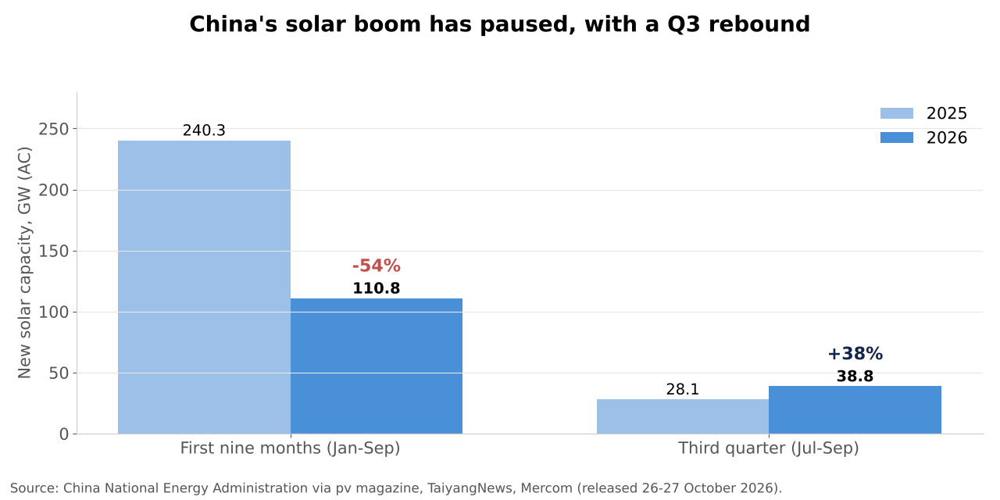
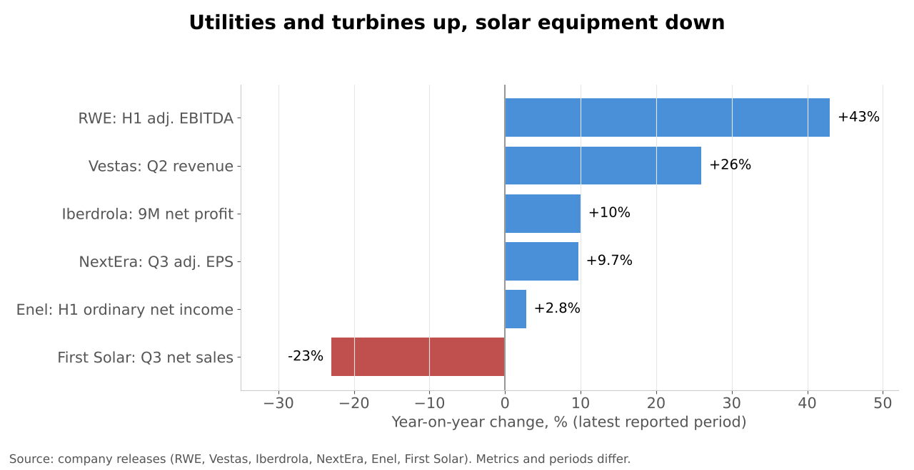
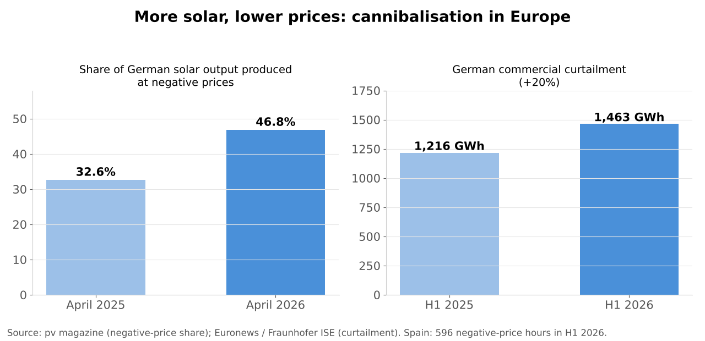
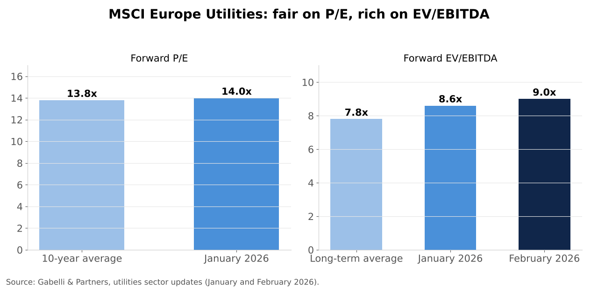
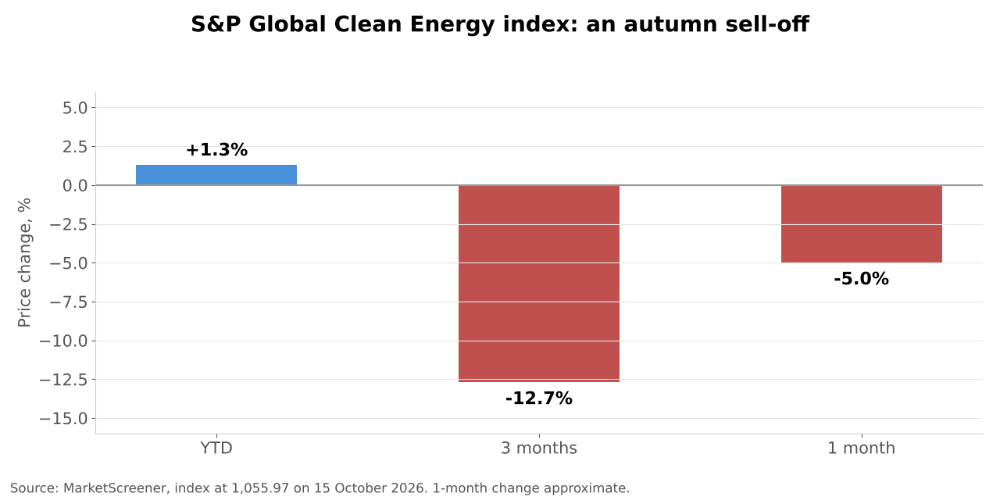

# Sector Overview #3 | Renewable Energy | November 2026

Published: 12 November 2026. Data as of 30 October 2026; market data "as of" the date stated next to it. Coverage: Europe, US, China.

---

## 1. Key takeaways

1. **Deployment is still at record levels, but growth is slowing.** Global renewable capacity additions rose 16% to about 800 GW in 2025 (IEA), the 23rd record year in a row, with solar above three quarters of the total. Investment in renewables, however, fell 9.5% in 2025 (BNEF) as China slowed.
2. **China has hit the brakes.** Chinese solar installations fell 54% to 110.8 GW in the first nine months of 2026 (NEA) after the move to market-based pricing, against 240.3 GW a year earlier. China installed nearly 500 GW of renewables in 2025, over 60% of the world total, so its slowdown drives the global cycle.
3. **Networks and utilities win, pure players struggle.** Iberdrola raised its guidance after a 10% rise in nine-month net profit (networks 54% of EBITDA) and RWE raised its 2026 EBITDA outlook to €5.75-6.35bn, while First Solar's Q3 sales fell 23% and the S&P Global Clean Energy index was up only 1.3% YTD in mid-October.
4. **Europe has a price problem, not a volume problem.** Record solar output (129 TWh in Q2 2026) pushed prices below zero for 596 hours in Spain in H1, and 46.8% of German solar output in April 2026 was produced during negative-price hours. Germany's 2025 offshore wind auction drew no bids.
5. **US policy is the swing factor.** Wind and solar projects had to start construction by 4 July 2026 to keep federal tax credits (otherwise in service by end-2027), and offshore wind faces repeated federal stop-work orders. At the same time, data centre demand is pulling in record PPAs and a $66.8bn NextEra-Dominion utility merger.

---

## 2. Sector snapshot

**Size.** Global annual renewable capacity additions reached about 800 GW in 2025 (+16%), led by solar PV (over 75%) and wind (20%); battery storage additions rose about 40% to almost 110 GW (IEA Global Energy Review 2026). In its Renewables 2025 report, the IEA expects about 4,600 GW of new renewable capacity between 2025 and 2030, a slight downgrade due to policy changes in the US and China.

**Investment.** Global energy transition investment reached a record $2.3tn in 2025 (+8%, BNEF), but renewables investment fell 9.5% because of the slowdown in China. China remained the largest market ($800bn, first decline since 2013); the EU grew 18% to $455bn and the US 3.5% to $378bn.

**Sub-segments and momentum.**
| Segment | 2026 trend |
|---|---|
| Solar PV | Volumes slowing in China (-54% in 9M); modules near $0.12/W for Chinese exports (OPIS); price pressure in Europe |
| Onshore wind | Steady; Vestas order intake +67% in Q2 2026, EBIT margin guidance raised to 7-9% |
| Offshore wind | Hard: US stop-work orders, German auction with no bids; Siemens Gamesa still near break-even |
| Battery storage | Fastest growth (+40% in 2025); 65% of NextEra's Q3 backlog additions |
| Electricity networks | Strong investment cycle (Iberdrola 9M investment €10.1bn, +13%, led by networks) |

**Value chain.** Raw materials and equipment (polysilicon, wafers, modules, turbines) → project development and construction → ownership and operation (utilities, independent power producers, infrastructure funds) → offtake (regulated tariffs, auctions with contracts for difference, corporate PPAs) → grids and storage. Equipment is commoditised and cyclical; value accrues to owners with contracted revenues, cheap capital and grid access.

---

## 3. Market dynamics

**Demand drivers.**
- **Cost.** Solar remains the cheapest new source of electricity in most markets; Chinese module prices near $0.12/W keep capex low.
- **Electricity demand.** Data centres are a new driver: the four largest hyperscalers accounted for 90% of North American PPA volumes in early 2026 (S&P Global), and Google signed a 1 GW, 15-year solar PPA with TotalEnergies in Texas.
- **Policy.** Auctions and subsidies still set the pace in Europe and China; the US shifted from incentives (IRA) to deadlines (OBBBA).
- **Energy security.** The Middle East war, which the ECB cited as a source of inflation pressure in 2026, strengthens the case for domestic generation in Europe.

**Cost structure.** Renewables are capital intensive with near-zero marginal cost: returns depend on the cost of capital and the price captured per MWh. Higher rates (ECB deposit rate 2.50%) raise financing costs, while low capture prices in sunny hours reduce revenues. This is why integrated utilities with regulated networks (stable, inflation-linked returns) outperform pure merchant developers.

**Pricing power.** Weak for equipment makers in oversupplied markets (solar), better for turbine makers after years of losses (Vestas margin 9.4% in Q2 2026 vs 1.5% a year earlier). For generators, pricing depends on contracts: two-sided CfDs and long-term PPAs protect revenues, merchant exposure does not.

**Cyclicality.** The sector is highly rate-sensitive (long-duration assets) and policy-driven. Equipment makers follow a boom-bust cycle; networks follow regulatory periods.

---

## 4. Macro and regulatory backdrop

**United States.**
- **Tax credits.** Under the 2025 OBBBA law, wind and solar projects keep the 45Y/48E credits only if construction started by 4 July 2026; otherwise they must be in service by 31 December 2027. A federal court restored the 5% safe harbor on 6 June 2026, but an appeal was expected and the legal standard remains unsettled.
- **Offshore wind.** Ørsted's Revolution Wind was hit by stop-work orders in August and December 2025; courts allowed construction to resume and the project started delivering power in March 2026, but in late October 2026 the administration was moving to reconsider its permits.
- **Tariffs.** First Solar described Section 232 as a structural change for US solar manufacturing, a tailwind for domestic producers and a cost for importers.

**China.**
- The move to market-based pricing for new projects ended the 2025 installation rush (93 GW of solar in May 2025 alone). Solar installations fell to 110.8 GW in 9M 2026, although Q3 (38.8 GW) was above Q3 2025 (28.1 GW). The CPIA still forecasts 180-240 GW for 2026; TaiyangNews estimates under 150 GW is more likely.
- Cumulative Chinese solar capacity reached 1,313 GW at end-September 2026 (+16.5%).

**Europe.**
- **Cannibalisation.** Europe produced a record 129 TWh of solar in Q2 2026. Spain recorded 596 negative-price hours in H1; French day-ahead prices hit a record low in April; German commercial curtailment rose 20% in H1 2026.
- **Offshore wind auctions.** Germany's August 2025 auction (2.5 GW) received no bids under a negative-bidding design. The 2026 round kept the same design; a draft reform published in August 2026 would introduce two-sided CfDs.
- **Rates.** The ECB raised its deposit rate to 2.25% in June and 2.50% in September 2026, raising the cost of capital for projects.

---

## 5. Competitive landscape

The sector splits into three business models: integrated utilities with networks, renewable developers and independent power producers, and equipment makers.

| Company | Model | Latest results | 2026 guidance / backlog | Positioning |
|---|---|---|---|---|
| Iberdrola | Utility (networks + renewables) | 9M net profit €5.8bn (+10%) | Raised to double-digit growth | Networks 54% of EBITDA; UK, US, Brazil |
| NextEra Energy | US utility + developer | Q3 adj. EPS $1.24 (+9.7%) | EPS $3.92-4.02 (high end); backlog 36.7 GW | Largest US developer; acquiring Dominion |
| Enel | Utility (networks + renewables) | H1 ordinary net income €3.93bn (+2.8%) | Ordinary EBITDA €23.1-23.6bn | Iberia and Latin America; €1.5bn buyback |
| RWE | Generator (offshore, onshore, flexible) | H1 adj. EBITDA about €3.0bn (+43%) | Raised to €5.75-6.35bn | Offshore wind main driver |
| Ørsted | Offshore wind developer | H1 2026: on track | EBITDA > DKK 28bn | Divestments of about DKK 46bn completed; US exposure |
| EDP Renováveis | Developer (asset rotation) | H1 2026 profit €184m | EBITDA €2.2-2.3bn (raised) | Builds and sells stakes; about €300m rotation gains |
| Vestas | Turbine maker | Q2 revenue €4.7bn (+26%), EBIT 9.4% | Revenue €20-22bn, EBIT margin 7-9% | Backlog €76.9bn; margin recovery |
| Siemens Gamesa | Turbine maker (Siemens Energy) | Q2 FY26 loss €44m (vs €249m) | Break-even in FY26 | Turnaround; no new offshore orders in Q2 |
| First Solar | Solar modules (US) | Q3 sales $1.23bn (-23%), net income $571m | $500m buyback | US manufacturing, tariff protection |

*Latest available figures as of 30 October 2026; periods and metrics differ by company. Ørsted, RWE, Enel, EDPR and Vestas Q3 2026 results were not yet published at that date.

**Who is gaining and losing ground.**
- **Gaining:** utilities with large regulated networks (Iberdrola, Enel), US players exposed to data centre demand and storage (NextEra), turbine makers back to profit (Vestas).
- **Losing:** pure offshore developers with US exposure (Ørsted), equipment makers in oversupplied segments, and merchant solar in Europe where capture prices collapse.

---

## 6. Valuation

**Basis.** Integrated utilities are valued on P/E and EV/EBITDA; developers often on the value of their contracted portfolio (sum of the parts); equipment makers on EV/EBIT through the cycle. We did not have access to a market data terminal; figures below are from published sector updates and data providers.

**Sector multiples (sourced).**
- MSCI Europe Utilities traded at about **14x forward P/E** in January 2026, in line with its 10-year average of 13.8x, and about **8.6x forward EV/EBITDA**, 10% above its long-term average of 7.8x (Gabelli). By February the EV/EBITDA multiple had reached about **9.0x**, just above the top of its historical range.
- European utilities traded at about a **30% discount to US utilities** (Gabelli, January 2026).
- Iberdrola, the sector's quality name, traded at about **11.7x 2026 EV/EBITDA** (MarketScreener), a clear premium to the sector, reflecting its network growth.

**Reading the numbers.**
- The market pays for regulated growth: network-heavy utilities trade at premiums, while pure renewable developers are valued on project returns versus their cost of capital.
- European utilities are no longer cheap versus history on EV/EBITDA, but remain cheaper than US peers; the gap is linked to faster US demand growth (data centres).
- For developers, every 1 point increase in rates lowers the value of long-duration contracted cash flows, which explains why clean energy indices fell in the autumn as yields rose.

---

## 7. Recent performance and capital markets activity

**Share price performance.**
- S&P Global Clean Energy index: **+1.3% YTD** at 1,055.97 on 15 October 2026, after **-12.7% over three months** and about -5% over one month (MarketScreener). In August the related Clean Energy Select index was still up 15.6% YTD.
- In April 2026 UBS noted that European renewables were up 14% YTD against +5% for the Stoxx 600, with Ørsted and RWE among the top performers and Iberdrola lagging.
- Dispersion is extreme: fuel-cell maker Bloom Energy rose more than 200% in 2026 on data centre demand, while the iShares Global Clean Energy ETF was up about 8%.

**M&A (last 12 months).**
| Date | Deal | Value | Rationale |
|---|---|---|---|
| May 2026 | NextEra Energy to combine with Dominion Energy (all stock) | about $66.8bn including debt | Largest regulated US utility; data centre demand in Virginia; closing expected 2027 |
| 3 Aug 2026 | TotalEnergies buys Shell's European onshore wind and solar (about 4 GW); sells 50% of a 1.2 GW portfolio to KKR | KKR stake at EV €1.8bn | Majors consolidate or recycle capital |
| 29 Apr 2026 | Blackstone invests up to €2bn in Eurowind Energy | up to €2bn | Private capital backs developers |
| Feb 2026 | CIP buys Ørsted's European onshore platform (now Perigus) | €1.44bn | Ørsted's divestment programme (about DKK 46bn in total) |

**ECM / balance sheets.** Ørsted completed a DKK 60bn rights issue in 2025 to fund its offshore pipeline after the US setbacks; EDP Renováveis relies on asset rotation (stake sales at more than 40% gains on invested capital in Italy and the US). Utilities are funding record capex with buybacks still running (Enel €1.5bn; First Solar $500m).

---

## 8. Key themes for the next 12-24 months

**Theme 1: Grids are the bottleneck and the opportunity.**
Curtailment and negative prices show that generation has outgrown networks and storage. *So what:* capital shifts from generation to grids and batteries; network-heavy utilities (Iberdrola, Enel) and storage developers benefit, merchant solar suffers.

**Theme 2: Data centres change US demand.**
Hyperscalers dominate PPA volumes and are signing gigawatt-scale deals (solar, nuclear). *So what:* US utilities and developers with grid access and fast permitting earn a premium; consolidation (NextEra-Dominion) follows the demand.

**Theme 3: China's reset spreads oversupply.**
With domestic installations down sharply, Chinese manufacturers export more, keeping module prices near record lows. *So what:* cheap equipment helps developers outside China, but pressures Western manufacturers, which rely on tariffs (First Solar).

**Theme 4: Offshore wind needs a new contract model.**
Zero-bid auctions and US political risk show that negative bidding and merchant risk do not work at current costs and rates. *So what:* two-sided CfDs (draft reform in Germany) are the condition for new investment; until then, expect delays, cancellations and asset sales.

---

## 9. Risks: bull case vs. bear case

| | Bull case | Bear case |
|---|---|---|
| Demand | Data centres and electrification lift power demand; record PPAs | AI capex slows; demand growth disappoints |
| Rates | Rate cuts lower the cost of capital and rerate developers | ECB and Fed stay higher for longer; long-duration assets derate |
| Policy | Germany adopts CfDs; US courts protect permits and safe harbor | More US stop-work orders; tax credit appeals succeed |
| Prices | Storage reduces cannibalisation; capture prices recover | More negative-price hours; merchant revenues fall further |
| China | Installations recover in Q4 and 2027 | Oversupply deepens; trade conflicts spread |

---

## 10. Names to watch (no ratings)

**Iberdrola.** The sector's network champion: nine-month net profit up 10% to €5.8bn, networks at 54% of EBITDA and guidance raised to double-digit growth. The key question is whether a premium valuation (about 11.7x EV/EBITDA) is justified by regulated growth in the UK, US and Brazil as procurement costs rise.

**Vestas.** A turnaround story: revenue up 26% and an EBIT margin of 9.4% in Q2 2026 (from 1.5%), with a record backlog of about €77bn and margin guidance raised to 7-9%. The debate is whether pricing discipline lasts as offshore wind stalls and Chinese turbine makers expand abroad. Next catalyst: Q3 2026 results.

**Ørsted.** The highest-risk name: divestments completed (about DKK 46bn) and 2026 EBITDA guidance above DKK 28bn, but its US offshore projects remain exposed to federal decisions (Revolution Wind permits under review). A clear resolution in the US would be the main rerating trigger; a further setback the main downside risk.

---

## 11. Sources

**Market sizing and industry studies**
- IEA, Global Energy Review 2026 (solar PV and wind): https://www.iea.org/reports/global-energy-review-2026/technology-solar-pv-and-wind
- IEA, Global Energy Review 2026 (key findings): https://www.iea.org/reports/global-energy-review-2026/key-findings
- IEA, Renewables 2025: https://iea.blob.core.windows.net/assets/76ad6eac-2aa6-4c55-9a55-b8dc0dba9f9e/Renewables2025.pdf
- BloombergNEF, energy transition investment 2025: https://about.bnef.com/insights/clean-energy/bloombergnef-finds-global-energy-transition-investment-reached-record-2-3-trillion-in-2025-up-8-from-2024/
- Energy Institute, BNEF investment figures: https://knowledge.energyinst.org/new-energy-world/article?id=140108
- pv magazine, China solar installations 9M 2026: https://www.pv-magazine.com/2026/10/27/chinas-solar-installations-fall-54-year-on-year-despite-september-rebound/
- TaiyangNews, China 9M 2026 solar installations: https://taiyangnews.info/markets/china-9m-2026-solar-installations
- Mercom, China solar additions 9M 2026: https://www.mercomindia.com/chinas-solar-capacity-additions-drop-53-9-in-9m-2026
- pv magazine India, China module prices H2 2026 (OPIS): https://www.pv-magazine-india.com/?p=14117
- TaiyangNews, PV price index CW38 2026: https://taiyangnews.info/price-index/taiyangnews-pv-price-index-cw38-2026

**Europe: prices and auctions**
- pv magazine, Europe's record solar output and negative prices: https://www.pv-magazine.com/2026/07/15/europes-record-solar-output-drives-surge-in-negative-electricity-prices/
- Bloomberg, record negative prices in Europe: https://www.bloomberg.com/news/articles/2026-04-30/european-power-plunges-to-record-negative-prices-on-solar-surge
- Fraunhofer ISE, solar power across Europe: https://www.ise.fraunhofer.de/en/press-media/press-releases/2026/solar-power-on-the-rise-across-europe.html
- Euronews, wind and solar overtake fossil fuels in Germany: https://www.euronews.com/2026/07/29/wind-and-solar-overtake-fossil-fuels-in-germany-but-negative-electricity-prices-still-rife
- Pexapark, European solar capture factors: https://pexapark.com/blog/european-solar-capture-factors-collapse-as-april-oversupply-triggers-wave-of-negative-prices/
- Offshore Magazine, no bids in German offshore wind auction: https://www.offshore-mag.com/renewable-energy/news/55308675/germany-receives-no-bids-in-zero-subsidy-offshore-wind-auction
- Baltic Wind, German 2026 offshore auctions without reform: https://balticwind.eu/german-wind-industry-2026-offshore-auctions-without-structural-reform/
- Clean Energy Wire, industry urges postponement of 2026 auctions: https://www.cleanenergywire.org/news/offshore-wind-industry-urges-postponement-germanys-2026-auctions-optimise-bids

**United States: policy and demand**
- Nixon Peabody, court restores 5% safe harbor: https://www.nixonpeabody.com/insights/alerts/2026/06/10/court-restores-five-percent-safe-harbor-before-july-4-2026-deadline
- Site Selection Group, July 4, 2026 begin-construction deadline: https://info.siteselectiongroup.com/news/wind-and-solar-hit-a-july-4-2026-begin-construction-deadline
- CNBC, court allows offshore wind construction to resume: https://www.cnbc.com/2026/02/02/us-court-again-rules-an-offshore-wind-project-can-resume-construction.html
- Rhode Island Current, Revolution Wind impairment: https://rhodeislandcurrent.com/2026/02/09/revolution-wind-developer-records-10m-q4-impairment-from-trump-suspension-order/
- Data for Progress, Revolution Wind permits (Oct 2026): https://dataforprogress.org/blog/2026/10/28/voters-support-offshore-wind-energy-projects-and-revolution-wind-in-particular-despite-federal-pushback
- S&P Global, North America's PPA market: https://www.spglobal.com/energy/en/news-research/blog/electric-power/033026-north-americas-ppa-market-beyond-volumes
- ENKI, Google-TotalEnergies gigawatt PPA: https://enkiai.com/solar/gigawatt-ppas-how-ai-redefined-hyperscaler-energy-in-2026/

**Company results**
- Iberdrola, 9M 2026 results: https://www.iberdrola.com/documents/20125/6290773/261021-iberdrola-9m-2026-net-profit-up-10-to-5-8-billion-networks-growth-all-geographies.pdf
- Securities.io, Iberdrola lifts 2026 outlook: https://www.securities.io/iberdrola-lifts-2026-outlook-as-9m-profit-rises-10-to-5-8-billion/
- NextEra Energy, Q3 2026 results (SEC 8-K): https://www.sec.gov/Archives/edgar/data/0000753308/000075330826000077/neeq32026exhibit99.htm
- Mercom, NextEra storage backlog: https://mercomindia.com/nexteras-battery-storage-backlog-surges-as-q3-earnings-rise
- Enel, H1 2026 results (FIRSTonline): https://www.firstonline.info/en/enel-e-ancora-lestero-a-guidare-la-crescita-utile-in-aumento-a-39-miliardi-e-guidance-verso-il-top-del-range/
- Nasdaq / RTTNews, Enel H1 profit: https://www.nasdaq.com/articles/enel-h1-profit-rises
- RWE, ad hoc release 28 July 2026: https://www.rwe.com/en/investor-relations/financial-calendar-and-publications/news-and-ad-hoc-announcements/ad-hoc-announcements/ad-hoc-2026-07-28/
- SolarQuarter, RWE H1 2026 adjusted EBITDA: https://solarquarter.com/2026/08/14/rwe-reports-43-rise-in-h1-2026-adjusted-ebitda-to-e3-billion/
- Ørsted, H1 2026 results: https://www.energy-pedia.com/news/general/orsted-continues-its-strategic-progress--delivers-solid-operational-performance--and-is-on-track-to-deliver-on-its-2026-financial-guidance-204944
- Ørsted, rights issue completion: https://www.energy-pedia.com/news/denmark/orsted-reports-completion-of-rights-issue-and-strong-execution-of-business-plan-201856
- Windtech, EDP upgrades 2026 outlook: https://windtech-international.com/company-news/edp-upgrades-2026-outlook-after-stronger-first-half-performance
- Observador, EDP Renováveis H1 2026 profit: https://observador.pt/2026/07/29/lucros-da-edp-renovaveis-aumentam-96-no-primeiro-semestre-para-184-milhoes-de-euros/
- GreentechLead, Vestas Q2 2026: https://greentechlead.com/wind/vestas-revenue-jumps-26-to-e4-7-bn-as-wind-orders-surge-67-and-backlog-hits-e76-9-bn-54690
- Windtech, Siemens Gamesa outlook raised: https://www.windtech-international.com/company-news/siemens-gamesa-shows-improved-margin-performance-as-siemens-energy-raises-full-year-outlook
- Börse Express, Siemens Gamesa Q2 loss: https://www.boerse-express.com/news/articles/siemens-gamesa-verlust-auf-44-millionen-halbiert-905784
- First Solar, Q3 2026 results (SEC 8-K): https://www.sec.gov/Archives/edgar/data/0001274494/000127449426000211/ex991pressreleaseq3-2026.htm

**Markets, valuation and deals**
- MarketScreener, S&P Global Clean Energy index: https://www.marketscreener.com/quote/index/S-P-GLOBAL-CLEAN-ENERGY-I-46870326/
- S&P Dow Jones Indices, Clean Energy Select index: https://www.spglobal.com/spdji/en/indices/sustainability/sp-global-clean-energy-select-transition-index/
- Yahoo Finance, green stocks in 2026: https://finance.yahoo.com/markets/stocks/articles/5-green-stocks-crushed-clean-061807153.html
- Investing.com, UBS on European utilities: https://www.investing.com/news/stock-market-news/ubs-favors-these-european-utilities-stocks-as-rally-continues-4628725
- Gabelli, utilities sector update January 2026: https://gabelli.com/wp-content/uploads/2026/01/2026-01-26_Utilities-Sector-Update-Europe_Middle-East_APAC.pdf
- Gabelli, utilities sector update February 2026: https://gabelli.com/wp-content/uploads/2026/02/2026-02-26_Utilities-Sector-Update-Europe_Middle-East_APAC.pdf
- MarketScreener, Iberdrola valuation: https://www.marketscreener.com/quote/stock/IBERDROLA-S-A-355153/valuation/
- PrivSource, NextEra-Dominion merger: https://www.privsource.com/acquisitions/deal/nextera-energy-acquires-dominion-energy-in-66-8b-all-stock-merger-ane_9zSA3A
- KKR, 50% stake in TotalEnergies European portfolio: https://www.kkr.com/content/dam/kkr/country-sites/fr/press-release/20260803-kkr-to-acquire-a-50-percent-stake-in-a-portfolio-of-developed-renewable-assets-from-totalenergies-across-europe.pdf
- ESG Dive, TotalEnergies buys Shell's European renewables: https://www.esgdive.com/news/totalenergies-buys-all-of-shells-european-renewable-energy-assets/826849/
- ESG Today, Blackstone invests in Eurowind: https://www.esgtoday.com/blackstone-invests-e2-billion-in-european-renewables-developer-eurowind/
- Energywatch, Eurowind acquisition plans: https://energywatch.com/EnergyNews/wind/article19763400.ece

---

*Student research for educational purposes only. Not investment advice.*
